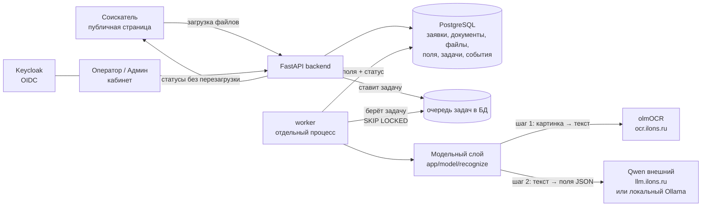

# Схема решения

## Диаграмма

## Пояснения

**Из каких частей состоит система**

- **Фронтенд соискателя** — публичная страница без входа. Соискатель выбирает
  страну, видит нужный набор документов, загружает файлы, следит за статусом
  разбора (обновление без перезагрузки через htmx-поллинг). Доступ к своей
  заявке — по невычисляемому токену (`applicant_token`), не по входу.
- **Кабинет оператора/админа** — закрыт входом через **Keycloak (OIDC)**.
  Оператор видит список заявок, карточку «оригинал рядом с полями», правит
  поля, запускает повторный разбор, видит очередь и историю заявки. Админ
  создаёт операторов.
- **Бэкенд (FastAPI)** — владеет данными и принимает все решения. Все проверки
  (тип файла, размер, формат полей, доступ) выполняются на сервере, не на
  клиенте. Приём файла мгновенный: файл сохраняется, ставится задача в очередь,
  соискателю сразу возвращается подтверждение.
- **Очередь задач** — хранится в PostgreSQL (не в памяти). Воркер забирает
  задачи через `SELECT ... FOR UPDATE SKIP LOCKED`, обрабатывает параллельно.
  При перезапуске сервера «зависшие» задачи возвращаются в очередь реапером —
  работа не теряется.
- **Воркер** — отдельный процесс. Берёт задачу, вызывает модельный слой,
  записывает извлечённые поля, прогоняет проверки и сопоставление ФИО/дат,
  ставит статус документа.
- **Модельный слой (`app/model/`)** — единственное место, где вызывается
  модель. Работает в два шага: **OCR** (olmOCR на `ocr.ilons.ru`) превращает
  картинку в текст, затем **LLM** (Qwen) извлекает из текста поля в JSON по
  промпту конкретного типа документа. Провайдер LLM выбирается настройкой
  `MODEL_PROVIDER`: `cloud` (внешний Qwen) или `local` (Ollama) — смена без
  правки кода.

**Где хранятся данные**

Всё в PostgreSQL: заявки, документы, файлы (метаданные + путь на диске), поля,
задачи очереди, события (история/журнал), результаты сопоставления. Сами
файлы-оригиналы лежат в хранилище на диске, в БД — ссылка. Всё переживает
перезапуск.

**Где вызывается модель**

Только в `app/model/`, через единую функцию `recognize(doc_type, image)`.
Нигде в роутах или обработчиках прямых вызовов модели нет. Адреса и ключи
моделей — в переменных окружения, не в коде.

**Готовность к локальной модели**

OCR (olmOCR) — открытая модель, разворачивается на своём железе. Внешний
контур = olmOCR + Qwen (внешний API). Полный on-prem = та же olmOCR на своём
сервере + локальный LLM (Ollama). Переключение провайдера проверено вживую
(см. `LOCAL_MODEL.md`).
