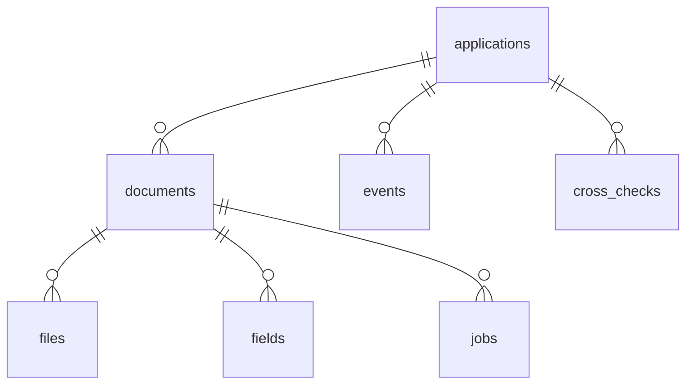

# Схема данных

TODO: одна схема + пояснения (Д10).

Таблицы: `applications`, `documents`, `files`, `fields`, `jobs`, `events`,
`cross_checks` — определения в `app/models.py`.

Пояснения к решениям схемы:
- TODO: почему дедуп по `(document_id, sha256)`.
- TODO: почему очередь — таблица `jobs`, а не брокер.
- TODO: почему `fields` — строки, а не JSON-колонка.
- TODO: почему содержимое файлов лежит в `STORAGE_DIR`, а не в БД.
