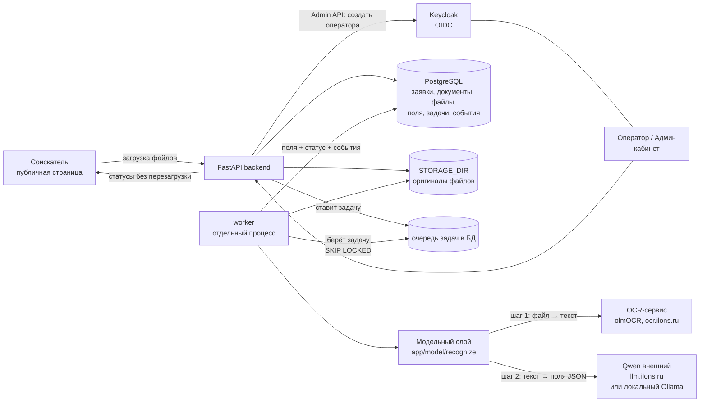
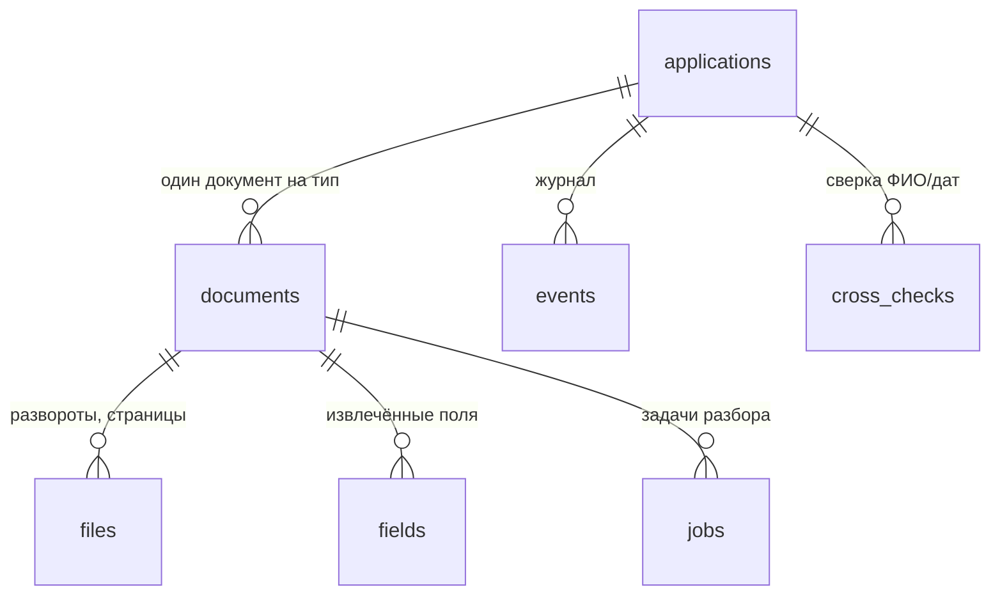

# Схема решения

## Диаграмма

## Из каких частей состоит система

- **Фронтенд соискателя** — публичная страница без входа. Соискатель выбирает
  страну, видит нужный набор документов, загружает файлы, следит за статусом
  разбора (обновление без перезагрузки через htmx-поллинг). Доступ к своей
  заявке — по невычисляемому токену (`applicant_token`), не по входу.
- **Кабинет оператора/админа** — закрыт входом через **Keycloak (OIDC,
  Authorization Code)**. Оператор видит список заявок, карточку «оригинал рядом
  с полями», правит поля, запускает повторный разбор, видит очередь и историю
  заявки. Админ создаёт операторов — приложение само вызывает Keycloak Admin API.
- **Бэкенд (FastAPI)** — владеет данными и принимает все решения. Все проверки
  (тип файла по содержимому, размер, объём, дубликаты, формат полей, доступ)
  выполняются на сервере. Приём мгновенный: файл сохраняется, ставится задача
  в очередь, соискателю сразу возвращается подтверждение.
- **Очередь задач** — таблица `jobs` в PostgreSQL (не в памяти). Воркер забирает
  задачи через `SELECT ... FOR UPDATE SKIP LOCKED` и разбирает до
  `WORKER_CONCURRENCY` документов одновременно. Задачи, взятые и не доведённые
  (рестарт, падение), реапер возвращает в очередь — работа не теряется.
- **Воркер** — отдельный процесс (`python -m app.worker`). Берёт задачу,
  распознаёт все файлы документа через модельный слой, записывает поля,
  прогоняет проверки и сопоставление ФИО/дат, ставит статус документа и заявки,
  пишет события. Сбой модели — понятный статус и повтор, процесс не падает.
- **Модельный слой (`app/model/`)** — единственное место, где вызывается
  модель. Два шага: **OCR** (olmOCR за HTTP-сервисом) превращает файл в текст,
  затем **LLM** извлекает из текста поля в JSON по промпту типа документа
  (`prompts/<doc_type>.txt`). Провайдер LLM — настройка `MODEL_PROVIDER`:
  `cloud` (Qwen через ilons) или `local` (Ollama), без правки кода.

## Где хранятся данные

Всё в PostgreSQL и переживает перезапуск. Оригиналы файлов — на диске в
`STORAGE_DIR` (docker-том `filedata`), в БД — путь, sha256, MIME и размер.

| Таблица | Что хранит |
|---|---|
| `applications` | страна, агрегированный статус, токен соискателя |
| `documents` | тип, статус (`accepted → processing → done / flagged / error`), причина для соискателя |
| `files` | имя от соискателя, путь в хранилище, sha256, MIME по содержимому, размер |
| `fields` | имя, значение, источник (`model` / `operator`), уверенность, замечание проверки |
| `jobs` | очередь: статус, попытки, кто взял, когда, последняя ошибка |
| `events` | журнал: кто (соискатель / worker / логин оператора), когда, что, причина |
| `cross_checks` | результат сверки ФИО и дат между документами заявки |

Почему так:

- **Дедуп по `(document_id, sha256)`** — повторная отправка того же файла в тот
  же документ не создаёт копию и вторую задачу, а тот же файл в другом
  документе — легитимный случай (одна скан-копия на два вида).
- **Очередь — таблица, а не брокер** — задача, документ и поля меняются одной
  транзакцией в одной БД, поэтому после рестарта не бывает «задача выполнена,
  а поля не записаны». Подробнее — `DECISIONS.md`, решение 1.
- **`fields` — строки, а не JSON-колонка** — у каждого поля своя история
  (модель или оператор), своя уверенность и своё замечание; поиск по ФИО в
  кабинете — обычный индексируемый запрос.
- **Файлы на диске, а не в БД** — фото по несколько мегабайт раздували бы
  таблицы и бэкапы; БД хранит ссылку и хеш, отдаёт файл только маршрут
  оператора после входа.

## Где вызывается модель

Только в `app/model/`, через единую функцию `recognize(doc_type, file_bytes)`.
Её вызывает только воркер; в роутах и шаблонах вызовов модели нет. Адреса и
ключи моделей — в переменных окружения.

## Готовность к локальной модели

OCR (olmOCR) — открытая модель, разворачивается на своём железе. Сейчас:
olmOCR (сервис организаторов) + Qwen (внешний API). Полный on-prem: olmOCR на
своём сервере + локальный LLM (Ollama). Переключение LLM проверено вживую —
см. `LOCAL_MODEL.md`.
